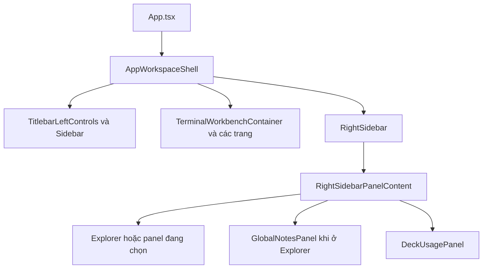

# Bàn giao UI Lamng Orca cho DeepSeek Harness

Cập nhật: **2026-10-22**. Mã nguồn: repo `orca-deck`, mốc HEAD lúc viết `00bc7be36`.
Tài liệu mô tả UI đã tùy biến trong workspace này, các quyết định của người dùng và cách sửa tiếp.
Đây là bản đồ thực hành cho agent kế tiếp, không phải mô tả mọi subsystem của Orca.
Nhiều thay đổi đang nằm trong working tree, **chưa commit**. Không dùng HEAD làm ảnh chụp đầy đủ UI hiện tại.

## 1. Đọc gì trước khi sửa

1. [AGENTS.md](AGENTS.md): quy trình và ràng buộc hiện hành; ưu tiên hơn tài liệu này.
2. [docs/STYLEGUIDE.md](docs/STYLEGUIDE.md): design system, token, primitive và gate kiểm tra.
3. [DECK_AGENT_UX.md](DECK_AGENT_UX.md): các lựa chọn người dùng đã chốt theo thời gian.
4. `.handover/LATEST.md`: việc gần nhất, bằng chứng kiểm tra và phần còn dang dở; file này không đưa vào git.
5. `git status --short`, `git log --oneline -10`, rồi đọc đúng phần code sẽ sửa.

Trong `DECK_AGENT_UX.md` có cả các bản thử đã bị thay thế. Quyết định mới hơn của người dùng thắng quyết định cũ.
Khi tài liệu khác với code hiện tại, kiểm tra code và cập nhật tài liệu; đừng khôi phục thiết kế cũ theo trí nhớ.

## 2. Người dùng muốn UI như thế nào

- Nền tối, chrome gọn, monochrome; màu dùng cho trạng thái và logo agent.
- Orca vẫn là ứng dụng làm việc thật: chọn workspace, mở agent, terminal, editor và file tree phải tiếp tục hoạt động.
- Chuyển động ngắn, thấy rõ nhưng nhẹ: trượt vài pixel, viền chọn di chuyển, nút nhấn nảy nhỏ.
- Tên gọi người dùng: **LamngOrcaAnimation**. Đây là cách gọi cho các hiệu ứng hiện có, không phải một thư viện hay engine riêng.
- Không remount terminal hoặc resize PTY để tạo hiệu ứng. Tôn trọng `prefers-reduced-motion`.
- Cần cài thay đổi vào Orca đang dùng; chỉ sửa source hoặc mở dev app chưa đủ để nói đã cài xong.
- Giữ nguyên dữ liệu phiên, tài khoản, cấu hình provider/model và các terminal đang chạy.

### Những lựa chọn đã chốt

| Khu vực           | Hiện tại cần giữ                                                                               |
| ----------------- | ---------------------------------------------------------------------------------------------- |
| Góc trái titlebar | Logo Orca gốc và nút sidebar                                                                   |
| Nhận diện cá nhân | Chữ ký Lamng, Yuji ngay bên phải chữ ký; cụm này nằm phía phải hàng titlebar bên trái          |
| Menu ứng dụng     | Bấm Yuji; nút ba chấm cũ đã bỏ                                                                 |
| Back/Forward      | Bỏ hai nút khỏi titlebar, giữ hành vi/shortcut có sẵn                                          |
| Caption workspace | Ngay bên phải dấu **+** trong tab strip, inset nhỏ; không còn căn giữa khoảng trống            |
| Tab strip chật    | Caption ellipsis/ẩn khi thiếu chỗ; không đẩy nút + hoặc nút điều khiển ra ngoài                |
| Quick agent       | Worktree → Folder → Terminal → **DeepSeek Harness** → Claude → Codex → Antigravity → +         |
| DeepSeek          | Quick slot (`dsh`); icon cá voi dùng chung, picker phiên có New session + history              |
| OpenCode          | Nằm trong menu **+**; history gộp OpenCode v1/v2, giữ đúng agent của phiên khi resume          |
| Command           | Chỉ icon ▶ ở thanh dưới cùng, trước Reveal/Workspace board; không hiện chữ Command             |
| Sidebar agent     | Giữ **title phiên**; model/metadata để ở hover có sẵn                                          |
| Workspace chọn    | Một viền bao workspace, di chuyển mượt giữa các mục; không dịch nội dung bên trong             |
| Pane terminal     | Viền bình thường; giữ cảnh báo đang chờ trả lời theo UX, không thêm lại viền active trắng chói |
| Notes             | Một ghi chú **dùng chung toàn Orca**; không tách mỗi workspace                                 |
| Usage             | Chi phí API ước tính từ log; không gọi đây là hóa đơn subscription                             |
| David Laid        | Ảnh grayscale trong suốt, góc dưới phải Usage; thanh và số tiền chừa chỗ cạnh ảnh              |

### Những bản thử đã bỏ: đừng tự thêm lại

- Thay title sidebar bằng `model · reasoning`: người dùng đã yêu cầu quay lại title.
- Chữ ký **outside** dưới David: đã bị yêu cầu xóa.
- David ở phía trên card hoặc chữ nằm trên ảnh: đã thay bằng vị trí dưới cùng và bố cục chừa chỗ.
- Caption workspace căn giữa phần trống hoặc đẩy sát mép phải: đã thay bằng vị trí ngay sau +.
- Dòng breadcrumb project/branch cũ ở header và các nút Back/Forward đã bỏ.

## 3. Bản đồ code: sửa khu vực nào thì vào đâu

Các đường dẫn dưới đây tính từ root repo.

| Việc cần làm               | Điểm vào chính                                                                                                                           |
| -------------------------- | ---------------------------------------------------------------------------------------------------------------------------------------- |
| Root và các service UI     | `src/renderer/src/App.tsx`                                                                                                               |
| Khung trái / giữa / phải   | `src/renderer/src/app-shell/AppWorkspaceShell.tsx`                                                                                       |
| Token, font, theme chuẩn   | `src/renderer/src/assets/main.css`                                                                                                       |
| CSS riêng của Deck/Lamng   | `src/renderer/src/assets/deck-chrome.css`                                                                                                |
| Primitive có sẵn           | `src/renderer/src/components/ui/`                                                                                                        |
| Logo Orca, Lamng, Yuji     | `src/renderer/src/app-shell/TitlebarLeftControls.tsx`, `LamngSignature.tsx`                                                              |
| Quick launch agent         | `src/renderer/src/components/sidebar/DeckCreateBar.tsx`                                                                                  |
| Chọn tài khoản             | `src/renderer/src/components/sidebar/DeckAgentAccountPicker.tsx`                                                                         |
| Chọn phiên / phiên mới     | `src/renderer/src/components/sidebar/DeckAgentSessionPicker.tsx`                                                                         |
| Điều phối launch/resume    | `src/renderer/src/components/sidebar/deck-agent-session-launch.ts`                                                                       |
| Launch với account         | `src/renderer/src/components/sidebar/deck-account-agent-launch.ts`                                                                       |
| Split trong tab đang có    | `src/renderer/src/components/sidebar/deck-agent-split.ts`                                                                                |
| Thanh công cụ dưới trái    | `src/renderer/src/components/sidebar/SidebarToolbar.tsx`                                                                                 |
| Nút VS Code / File Manager | `src/renderer/src/components/sidebar/WorkspaceOpenButton.tsx`                                                                            |
| Luồng Open in chuẩn        | `src/renderer/src/components/sidebar/WorktreeOpenInMenu.tsx`                                                                             |
| Đích workspace đang chọn   | `src/renderer/src/lib/workspace-chrome-target.ts`                                                                                        |
| Viền chọn di chuyển        | `src/renderer/src/components/sidebar/DeckWorkspaceSelectionFrame.tsx`                                                                    |
| Chỗ mount viền trong list  | `src/renderer/src/components/sidebar/worktree-list/viewport/VirtualizedWorktreeViewport.tsx`                                             |
| Agent row đầy đủ / gọn     | `src/renderer/src/components/dashboard/DashboardAgentRow.tsx`, `src/renderer/src/components/sidebar/worktree-card-compact-agent-row.tsx` |
| Caption sau +              | `src/renderer/src/components/tab-group/WorkspaceStripLabel.tsx`, `src/renderer/src/components/tab-bar/tab-bar-surface.tsx`               |
| Command icon/editor/menu   | `src/renderer/src/components/tab-bar/TabBarQuickCommandsButton.tsx`, `TabBarQuickCommandsMenu.tsx`                                       |
| Bố cục sidebar phải        | `src/renderer/src/components/right-sidebar/right-sidebar-panel-content.tsx`                                                              |
| File tree                  | `src/renderer/src/components/right-sidebar/FileExplorer.tsx` và các `useFileExplorer*` hiện có                                           |
| Notes dùng chung           | `src/renderer/src/components/right-sidebar/GlobalNotesPanel.tsx`                                                                         |
| Usage + David              | `src/renderer/src/components/right-sidebar/DeckUsagePanel.tsx`                                                                           |
| Đọc chi phí                | `src/renderer/src/components/right-sidebar/use-deck-usage-overview.ts`, `src/renderer/src/components/stats/usage-overview-model.ts`      |
| Entry animation dùng chung | `src/renderer/src/hooks/use-surface-entry-animation.ts`                                                                                  |
| Surface terminal           | `src/renderer/src/components/TerminalWorkbenchContainer.tsx`                                                                             |
| Ẩn prompt account-switched | `src/renderer/src/components/CodexRestartChip.tsx`                                                                                       |
| Import appearance một lần  | `src/renderer/src/lib/deck-appearance-import.ts`                                                                                         |

Luồng khung chính:



Đây là sơ đồ khu vực UI, không phải toàn bộ call graph hoặc data flow.

## 4. Quick slot DeepSeek Harness và OpenCode

- ID nội bộ: `dsh`; tên hiển thị: **DeepSeek Harness**.
- Quick slot là DeepSeek Harness (`dsh`); OpenCode nằm trong menu **+** và giữ nguyên picker/history của nó. Cả hai dùng `AgentIcon` và `getAgentLabel` có sẵn trong `src/renderer/src/lib/agent-catalog.tsx`.
- Asset dùng chung: `src/shared/agent-icons/dsh.png`; desktop map qua `src/renderer/src/lib/agent-favicon-assets.ts`.
- Logo cá voi hiện có đã được chuẩn bị ở phiên khác trước task này; không vẽ lại hoặc tải asset mới nếu không cần.
- Cấu hình CLI nằm tại `src/shared/tui-agent-config.ts`: detect `dsh-tui`, cần `dsh`, launch `dsh-tui .`.
- Đừng đổi `launchCmd`, provider, model, auth hoặc biến môi trường chỉ để đổi logo hay vị trí nút.
- Icon, nhãn và agent gửi vào picker phải đồng nhất: quick slot là `dsh`, mục OpenCode trong menu + là `opencode`.
- DeepSeek đã nằm trong `AI_VAULT_AGENTS` (`src/shared/ai-vault-types.ts`) và có source history riêng; picker liệt kê session của worktree đang chọn, bấm một dòng là resume bằng `dsh-tui --resume <id>`.
- Scanner: `session-scanner-dsh-paths.ts` + `session-scanner-dsh-parser.ts`. Root: `DSH_TUI_SESSION_ROOT`, rồi `$DSH_HOME/sessions`, rồi `~/.dsh-tui/sessions`.
- Log dsh là zstd **nhiều frame** (mỗi lần ghi một frame). Node trong Electron 43 chỉ giải frame đầu; parser cắt theo magic và giải từng frame, giữ các frame đã ghi khi frame cuối đang viết dở. Khi sửa parser, phải kiểm tra trong app đóng gói, không chỉ test Node 26.
- Remote/SSH đọc projection `$DSH_HOME/storages/session_projcache/sessions/<id>.json` (không có messageCount/model). `DSH_HOME` và `DSH_TUI_SESSION_ROOT` phải nằm trong env allowlist của AI Vault service child, nếu không app đóng gói sẽ bỏ qua DSH home đã đổi chỗ.
- Khi kiểm tra UI, mở/đóng picker đủ kiểm tra routing; không cần chạy CLI trả phí hay đổi account.

### History và animation OpenCode (2026-10-22)

- `deck-session-agent.ts` gộp history `opencode` + `opencode2` khi mở picker OpenCode từ menu +; mục OpenCode 2 riêng vẫn chỉ lấy v2. Claude Teams vẫn dùng history Claude.
- Khi resume từ quick slot, `getDeckSessionLaunchAgent` giữ agent của phiên v2 để dùng command/override v2 hiện có. Không nới lỏng kiểm tra khác agent hoặc execution host.
- Picker OpenCode dùng New session riêng ngoài danh sách cmdk: Enter khi tìm kiếm chọn phiên phù hợp, không vô tình tạo phiên mới.
- Hai scope This workspace / All sessions; lọc đúng host, giữ tên phiên, nhãn phiên bản và thời gian. Tìm kiếm và chuyển trang trên dữ liệu đã tải, không gọi scan lại mỗi phím.
- Tải đầu 250 kết quả (giới hạn chung API, không chỉ OpenCode), 20 dòng/trang; Load older tăng tới 2000, Refresh mới force scan. Không thêm IPC/cache riêng. Lịch sử sâu hơn cần AI Vault.
- CLI đang cài là OpenCode v2.0.32. Chỉ thêm `"animations": false` vào `~/.config/opencode/cli.json`, giữ mọi giá trị khác và quyền file, backup trong thư mục bằng chứng `orca-opencode-ui/2026-10-22`.
- Đây là cấu hình giao diện riêng của CLI ([tài liệu chính thức](https://dev.opencode.ai/v2/docs/cli/config)), không phải `opencode.json` cho server/provider. Không thay model/auth hay cấu hình provider.
- Chưa đo FPS/độ trễ trong cuộc chat thật; không kết luận đã hết mọi lag. Không tắt LamngOrcaAnimation toàn Orca để xử lý animation của CLI.

### Luồng launch cần giữ

`DeckCreateBar` → picker account nếu provider hỗ trợ → `DeckAgentSessionPicker` → `launchDeckAgentSession`.

Với DeepSeek, đi thẳng vào picker phiên, giống luồng agent không có account picker riêng.
`deckAgentHasAccountStep()` (`deck-account-agent-launch.ts`) là nguồn duy nhất cho câu hỏi "agent này có bước chọn account không" trong quick slot và picker: quick slot dùng nó cho tooltip và luồng mở picker, picker dùng nó cho nút X/Back to accounts và dòng account. Không lặp lại danh sách `claude/codex/antigravity` trong hai file đó.
Launch một phiên mới dùng split target hiện có nếu có; nếu chưa có target thì dùng luồng tạo tab chuẩn.
Resume các agent được hỗ trợ phải tuân thủ execution host của phiên, không mang session remote về local.
Không thay global selected account khi chỉ mở thêm CLI.
Chọn một workspace chỉ chọn workspace; không tự mở menu agent.
Account row chọn bằng check, nền trong suốt; hover/focus xem usage ở bên phải, không chèn xuống dưới làm khuất danh sách.
Giữ identity của account gắn với PTY/session qua title update và reload; không suy từ account global hiện tại.
Header pane giữ logo + title phiên; metadata để hover. Zoom bằng Ctrl/Cmd và wheel/pinch phải theo pane đang thao tác, không đổi zoom toàn app.

### Chỉ hiện phiên agent chính (2026-10-25)

- `DeckAgentSessionPicker` lọc cả `subagent` cũ và `isSubagent` mới trước search, scope và phân trang. Dùng chung cho mọi quick slot/menu +; không đổi tên phiên, không xóa dữ liệu.
- DSH trước đây mất dấu phiên con ở parser. `session-scanner-dsh-parser.ts` đọc `origin: subagent` trong session header và `rows.subagent.val.identity` trong projection SSH. Không dùng tên ENVIRONMENT, `parentSession` của một fork, hoặc `subagentCatalog` của phiên cha để đoán.
- `session-list-result-validation.ts` giữ `isSubagent` bằng schema boolean optional; đã test true/false/absent để tránh Zod strip mất dấu khi nhận lịch sử SSH/runtime.
- `isSubagent?: boolean` là field JSON tùy chọn: host cũ vẫn thiếu dấu này, nên cần nâng host nếu lịch sử SSH cũ vẫn hiện phiên con. Các parser local/raw/projection dùng cùng logic. Không thêm opcode hoặc trạng thái agent.
- Cache metadata tăng schema 3 → 4 để loại kết quả cũ chưa phân loại; lần quét đầu có thể lâu hơn. Các log/phiên thật giữ nguyên.
- 83 unit test khác nhau và 3 Electron E2E PASS (390/768/1440, dark/light), typecheck và quality/design-system PASS. Bản cài ẩn kiểm tra log→scanner→picker chỉ hiện main và search không tìm thấy child; [ảnh với dữ liệu thử](docs/assets/orca-main-agent-history.png). Chưa thử launch agent thật, live SSH hoặc host khác phiên bản.
- Đối chiếu 30 log thật: 23 child/7 main, khớp cả 30 projection. Tests dùng dữ liệu giả cho search/scope/page counts và bản cài ẩn dùng log trong home riêng. Bằng chứng và backup: `~/.local/state/orca-main-session-history/2026-10-25/`.

### Account/context sau khi CLI cập nhật (2026-10-23)

- Lỗi đã tái hiện: 1/2 profile Claude riêng không có `statusLine`; cấu hình chung và script vẫn còn. Không có bằng chứng updater xóa binary patch. `syncManagedHooksToConfigDir` trước đây chỉ sao hooks, để statusLine trống.
- Sửa trong `src/main/claude/hook-service.ts`: mỗi lần chuẩn bị launch, profile thiếu field nhận custom statusLine từ cấu hình chung. Giữ `null` (tắt rõ ràng) và command riêng của từng profile. Không thay credentials, account selection, model/provider hoặc managed usage feed.
- Script cá nhân đang dùng: `~/.claude/orca-session-info.cjs`; đăng ký bằng [statusLine chính thức của Claude](https://code.claude.com/docs/en/statusline). Nó đọc account từ CLAUDE_CONFIG_DIR của phiên và context từ stdin, không sửa file trong thư mục phiên bản CLI. Hai profile hiện tại đã được đối chiếu bằng payload thử; không gửi prompt trả phí.
- Codex 0.163.0: lưu `tui.status_line = ["model-with-reasoning", "context-used"]` ở cấu hình canonical và 5 home runtime/account đang có. Dùng [cấu hình footer native](https://developers.openai.com/codex/cli/slash-commands/); đường mirror/promotion có sẵn giữ field qua lần launch tiếp theo. Chỉ key đó thay đổi, các giá trị TOML khác đã đối chiếu.
- User chọn dòng account/context nhỏ ở đáy **khung terminal Orca**, vì footer native Codex chưa có email account. `CodexPaneSessionFooter.tsx` dùng `use-pane-account-identity.ts`, tách nguyên logic account đã có từ DeckPaneIdentity để header và footer thống nhất account gắn với PTY. Không suy từ account global hoặc local credentials của host khác.
- Context là **trình bày lại footer của chính CLI**, không thêm producer/status store hay API: đọc tối đa 8 hàng xterm quanh cursor/composer sau onWriteParsed, gộp theo animation frame; regex theo capture Codex 0.163.0 `Context N% used`, hỗ trợ legacy `N% context left`. Không quét scrollback, không polling hay chạy subprocess mỗi tick. Subscription/frame được hủy khi rời Codex/PTY/unmount.
- Giới hạn: native footer bị ẩn, format tương lai thay đổi, hoặc terminal quá hẹp làm mất native context → `ctx —`, không đoán phần trăm. Dòng account vẫn thuộc Orca, độc lập binary CLI. CLI cũ đang chạy cần mở lại để đọc status_line vừa lưu.
- Footer cao 24px theo spacing token, dành chiều cao thực trong terminal.css **và deck-chrome.css** để FitAddon tự refit; Chat view không có footer này. Account truncate có title đầy đủ; context đặt phải để tránh nút floating workspace ở giữa đáy cửa sổ hẹp.
- Verification: 405 test PASS, 5 platform-gated SKIP; typecheck, changed-code/design-system gate và format/diff PASS. Electron ẩn PASS ở 1440/768/390px, dark/light; packaged hidden smoke PASS. [Ảnh footer với dữ liệu thử](docs/assets/orca-cli-session-footer.png). Tests: missing profile slot (RED trước sửa, GREEN sau sửa, kể cả thay file hai lần), null/custom giữ nguyên; header pinning; native footer/context 0%, redraw, legacy, unknown và khác PTY/provider. Capture/backup/log: `~/.local/state/orca-cli-statusline/2026-10-23/`. Không commit dữ liệu account/transcript riêng.

## 5. Chi tiết các vùng dễ sửa nhầm

### Header và caption workspace

- Lamng là SVG fill dùng `currentColor`, trace trực tiếp từ mẫu chữ ký user đã duyệt ngày 2026-10-24; không phụ thuộc font. `LamngSignature.tsx` giữ vị trí/kích thước cũ. Yuji là PNG alpha: `src/renderer/src/assets/lamng-avatar.png`.
- [Ảnh chữ ký trong titlebar thật](docs/assets/orca-signature-titlebar.png). Đây là vector trace từ mẫu đã duyệt, không phải font hoặc chữ ký tự sinh lại.
- Yuji mở menu ứng dụng; không xóa hành vi đó khi chỉ sửa vị trí ảnh.
- Caption dùng `selectWorkspaceChromeTarget` để hiểu cả worktree và folder workspace.
- `.deck-workspace-strip-label` là named inline-size container; caption chỉ hiện khi còn ít nhất 140px.
- Tên dài truncate, path đầy đủ ở `title`. Giữ vùng kéo cửa sổ và các nút không bị drag-region nuốt click.
- Đừng đưa breadcrumb cũ trở lại khi caption ẩn ở màn hình hẹp; đó là chủ ý giữ chỗ cho tab/nút.

### Selection frame và chuyển động

- Một frame riêng theo workspace đang chọn, không dùng CSS transition làm cả card chạy theo.
- Frame ưu tiên surface `primary`, có fallback khi list virtualization chỉ mount surface khác.
- Theo dõi scroll, thay đổi DOM và kích thước qua các observer hiện có; cleanup khi unmount.
- `useSurfaceEntryAnimation`: 160ms, opacity .78 → 1; hủy animation cũ. Explorer dùng mặc định slide (`translateY(5px)` → 0); TerminalWorkbenchContainer phải truyền `'fade'` để xterm đứng đúng lưới pixel, không translate/scale.
- Explorer chỉ animate khi dữ liệu đã thuộc workspace đang chọn. Đừng animate dữ liệu cũ trong lúc cache mới chưa sẵn sàng.
- Không dùng terminal output làm trigger entry animation. Không animate từng ký tự xterm.
- Một số transition frame/nút nằm trong media query `prefers-reduced-motion: no-preference` của `deck-chrome.css`.

### Agent title, status và tài khoản

- Hai kiểu row cần đồng nhất về title và logo. Không chỉ sửa một kiểu rồi kết luận sidebar đã sửa xong.
- Model/reasoning là metadata của session; thiếu thì không đoán từ global default.
- Trạng thái agent do execution host/hook status store sở hữu. UI không sinh cache trạng thái mới để làm dấu tick “đẹp hơn”.
- Trước khi sửa producer/reader status, đọc `docs/reference/agent-status-store.md`.
- `CodexRestartChip` đang âm thầm dismiss prompt account/config switch cần trả lời, trả về `null`.
- Điều này giữ phiên cũ trên account khởi tạo, **không** chuyển account hay restart CLI tự động.
- Giữ lỗi auth thật và yêu cầu restart đã được người dùng chủ động đặt.

### Nút VS Code và mở folder

- `WorkspaceOpenButton` có hai application: `vscode`, `file-manager`.
- Dùng cùng selector target và `openWorktreePath`, không tự ghép path từ text của row.
- VS Code có luồng SSH hiện có; File Manager chỉ nhận local path và bị disable với remote/runtime không hợp lệ.
- Chặn click lặp khi đang mở; lỗi hiện bằng luồng toast có sẵn.
- Folder workspace không nhất thiết là Git repo. Đừng thêm yêu cầu branch/Git vào những nút này.
- Đây là mở VS Code bên ngoài. Task trước không xây một VS Code extension host bên trong Orca.

### Notes

- Một draft chung toàn ứng dụng/profile, hiện trong vùng Explorer, giữa cây file và Usage.
- Key localStorage: `orca.global-notes.v1`; lưu plain text ngay mỗi lần sửa.
- Có thu gọn, resize chiều cao bằng textarea, tăng/giảm cỡ chữ theo token và reset.
- Zoom và trạng thái thu gọn là state UI trong lần mount; **chưa lưu preference này qua lần mở lại**.
- Nội dung sống qua đổi workspace và reload; **chưa đồng bộ cloud**, không phải file trong Git repo.
- Read storage lỗi: hiện lỗi và read-only để không ghi đè dữ liệu chưa đọc được.
- Write storage lỗi: giữ text đang nhập, báo Not saved để người dùng có thể copy trước khi đóng.
- Không đổi key hoặc clear localStorage để “sửa giao diện”; nếu cần đổi storage phải có migration giữ nội dung.
- Chưa có cơ chế merge/conflict khi nhiều cửa sổ cùng sửa note; không quảng cáo đồng bộ thời gian thực.

### Usage và David

- Asset: `src/renderer/src/assets/david-laid-portrait.png`, ảnh alpha đã xử lý từ ảnh người dùng cung cấp.
- Dùng asset sẵn có; chỉnh bố cục bằng CSS trước khi nghĩ tới tạo lại ảnh.
- Image group absolute, `right: 8px`, `bottom: 8px`, nằm trên content và `pointer-events: none`.
- Cột dành cho ảnh nằm ở `.deck-usage-provider-list`, `.deck-usage-note`; số tiền vẫn align phải.
- Track ngắn hơn để vừa cạnh ảnh; **tỷ lệ phần trăm chi phí không bị sửa hoặc clamp giả theo ảnh**.
- Chiều cao viewport <=560px: ẩn ảnh và trả lại khoảng cột trống.
- Giữ period selector, refresh, stale/error behavior và Usage settings. Chỉ đổi hình không được sửa công thức tiền.
- Explorer được bọc vùng flex có overflow clip để cây không vẽ đè Notes khi cửa sổ chật.

## 6. Design system: sửa đẹp mà không phá token

- `main.css` là nguồn token chuẩn; `deck-chrome.css` là phần tùy biến có chủ ý, không phải chỗ đổi toàn bộ theme tùy hứng.
- Dùng `background/foreground`, `sidebar/*`, `muted`, `accent`, `border`, `ring` đúng vai trò.
- Dùng Geist/mono và size có sẵn; không thêm font ngoài chỉ để tạo cảm giác “xịn”.
- Tái sử dụng Button/Tooltip/Popover/Command/Textarea/Collapsible và variant có sẵn.
- Không restyle primitive bằng màu/font/border tùy ý ở call site. Đọc Enforcement/style gate trước khi đổi variant.
- Không thêm thư viện animation hoặc icon library thứ hai cho vài hiệu ứng.
- Không làm blur toàn sidebar hoặc animation liên tục làm mất tập trung vào terminal.
- Cỡ target, keyboard focus, tooltip và reduced motion là chức năng, không phải đồ trang trí có thể bỏ.
- Đọc flow icon `AgentIcon` trước khi hardcode `` cho riêng một chỗ.

## 7. Kiểm tra: chạy ẩn, kiểm tra đúng thứ

Mọi launch/test Electron phải có `ORCA_BACKGROUND_LAUNCH=1`.
Không gọi `show`, `showInactive`, `bringToFront`, `app.focus` hoặc kích hoạt cửa sổ hệ điều hành.
Dùng Playwright/CDP của renderer ẩn, profile/home test riêng; không dùng computer-use để kiểm tra UI Orca.
Skill `electron` không có trong các catalog/path đã kiểm tra ở task này; dùng fixture/probe ẩn có sẵn, không bịa rằng đã dùng skill đó.

Ví dụ các kiểm tra liên quan, chọn theo phạm vi sửa:

```bash
ORCA_BACKGROUND_LAUNCH=1 pnpm test src/renderer/src/components/sidebar/DeckCreateBar.quick-agents.test.tsx src/renderer/src/components/sidebar/deck-agent-split.test.ts
ORCA_BACKGROUND_LAUNCH=1 pnpm test src/renderer/src/components/right-sidebar/GlobalNotesPanel.test.tsx src/renderer/src/components/sidebar/WorkspaceOpenButton.test.tsx
pnpm tc:web
pnpm run check:code-quality:changed
git diff --check
```

E2E hiện có: `tests/e2e/deck-header-polish.spec.ts`, fixture `tests/e2e/helpers/orca-app.ts`.

```bash
ORCA_BACKGROUND_LAUNCH=1 pnpm exec playwright test --config tests/playwright.config.ts --project=electron-headless tests/e2e/deck-header-polish.spec.ts --workers=1
```

- Chỉ dùng `SKIP_BUILD=1` nếu `out/` đã được build đúng source hiện tại. Code launch-policy thay đổi thì phải rebuild trước khi chạy app.
- Screenshot phải đi cùng DOM bounds/computed styles và thao tác thật: picker mở đúng agent, nút còn bấm được, text không bị cắt sai.
- Kiểm tra 390/768/1440 theo workflow hiện hành và các trạng thái bị ảnh hưởng. Orca desktop có thể không phù hợp ở 390px; ghi rõ giới hạn thay vì giả định layout mobile hoàn chỉnh.
- Với desktop hẹp còn cần kiểm tra sidebar thu gọn, zoom UI, theme sáng/tối và reduced motion theo phạm vi.
- Tối đa hai vòng tự tinh chỉnh hình ảnh mỗi task; nếu không tiến triển thì ghi phần chưa giải quyết.
- `setUIZoomLevel` trên store không tự chứng minh Electron đã zoom. Muốn test zoom thật, gọi API `window.api.ui.setZoomLevel(...)` rồi đo lại.
- `deck-appearance-import.ts` import appearance một lần theo profile và hiện lưu UI zoom 2.5. Reload có thể đổi viewport CSS; kiểm tra zoom thật trước khi kết luận media query/layout lỗi.
- Nếu Git trong shell lỗi vì `GIT_CONFIG_COUNT/KEY/VALUE` thừa, bản ghi phiên trước có cách unset các biến đó **cho riêng process kiểm tra**. Không xóa cấu hình Git hay in giá trị có thể nhạy cảm.
- Không đưa CLI/account thật vào test UI nếu không cần; intercept IPC mở external editor/file manager để tránh bật app trên desktop người dùng.
- Không nhận vơ kết quả cũ là lần kiểm tra mới. Báo PASS/FAIL/SKIPPED/UNAVAILABLE cho những gì thực sự đã chạy.

## 8. Build và cài vào Orca đang dùng

Workspace source, thư mục `out/` và ứng dụng được launcher mở là **ba thứ khác nhau**.
Sau khi sửa source, app cài hiện tại không tự cập nhật.
Task này không tạo commit, push hoặc PR; cài UI trên máy không đồng nghĩa đã merge vào upstream GitHub.

### Chính sách đã dùng cho bản cá nhân này

1. Xác định launcher hiện trỏ vào app nào; đọc installation record gần nhất.
2. Build **renderer production** từ source hiện tại; không thay main/preload/backend bằng một build khác chỉ để ship CSS/icon.
3. Tạo app candidate mới dựa trên bản đang dùng; thay riêng `out/renderer/**` trong `resources/app.asar`.
4. So sánh byte và unpack flags cho mọi file ngoài renderer. Số file không đổi phải lấy từ record của từng lần cài, không dùng số cố định.
5. Chạy candidate ẩn với profile/home riêng; kiểm tra asset, picker, note, toolbar và hành vi cần sửa.
6. Sau PASS mới đổi desktop launcher và persistent hotkey; giữ backup để rollback.
7. Không restart Orca đang chạy của người dùng. Báo **Quit rồi mở lại từ menu ứng dụng**.

Đây là quy trình cài riêng Linux cho máy hiện tại, không phải thay thế hệ thống build/release đa nền tảng của Orca.
Giữ `.AppImage` gốc, dữ liệu account/profile và thư mục app trước đó để có đường lui.
App đã cài: `$HOME/Applications/Orca-1.4.220-Lamng-MainHistory`, clone từ `Lamng-SmoothCLI`; thay `out/main/**` và `out/renderer/**` cho scanner/picker, giữ nguyên 3669 file ngoài phạm vi và unpack flags, gồm preload production. Desktop launcher và persistent Super+A đã trỏ bản mới; không restart app đang chạy. Giữ `Lamng-SmoothCLI` để rollback. Bằng chứng: `~/.local/state/orca-main-session-history/2026-10-25/installation.json`. Chuỗi trước: SmoothCLI bỏ animation workbench, StableCLI thêm chữ ký vector, CliFooter khôi phục statusline/account-context.

Bằng chứng/quy trình cài cục bộ:

- `$HOME/.local/state/orca-notes/2026-10-21/`: bản Notes trước đó, package/smoke scripts, backup launcher.
- `$HOME/.local/state/orca-deepseek-ui/2026-10-22/`: task đổi quick slot DeepSeek và viết tài liệu này.
- `$HOME/.local/state/orca-dsh-sessions/2026-10-22/`: backend history DSH, không thay bằng main cũ.
- `$HOME/.local/state/orca-opencode-ui/2026-10-22/`: quick slot OpenCode, history, backup CLI animation và cài renderer.
- `$HOME/.local/state/orca-dsh-slot-ui/2026-10-23/`: quick slot DeepSeek Harness trở lại, package/smoke script, `installation.json`, ảnh bản cài và backup launcher.
- `$HOME/.local/state/orca-terminal-jitter/2026-10-24/`: chữ ký đã duyệt và fade terminal; RED 5px/GREEN 0px ở các frame entry thực; 35 unit/4 Electron E2E PASS, typecheck ứng dụng và quality/design-system PASS; hidden production smoke PASS. `typecheck:e2e` toàn repo có 215 lỗi ngoài file task, không phải gate (xem comment trong config). Không chạy hội thoại trả phí hoặc đo FPS cửa sổ foreground. Có `verification.json`, review, package/smoke/activate scripts và backup launcher.
- `$HOME/.local/state/orca-cli-smoothness/2026-10-24/`: bỏ hẳn fade của `TerminalWorkbenchContainer` theo yêu cầu người dùng. Đo trên bundle cài: bản cũ bật 1 animation workbench mỗi lần mở CLI, bản mới 0; grid đứng yên 0/80/160/320ms. Electron E2E 3 spec PASS, unit 8 PASS, typecheck + quality gate PASS, hidden production smoke PASS. Long task trong môi trường headless bị nhiễu bởi throttle 1 fps của Chromium nên chưa đo được FPS cửa sổ thật; cần người dùng xác nhận sau khi restart.
- Mỗi record có `installation.json`, app trước/sau, log kiểm tra và snapshot launcher.
- Script cài/probe có đường dẫn máy cụ thể; đọc trước khi tái sử dụng. Không chạy lại mù vào destination đã tồn tại.
- Launcher gồm desktop entry và persistent keybind Caelestia Super+A. Cấu hình hotkey trong bộ nhớ có thể cần reload bình thường; menu ứng dụng dùng desktop entry mới.

Nếu đổi backend/IPC/session code, renderer-only patch không đủ. Khi đó cần task build/compatibility riêng, không ghi “đã sửa” nếu candidate vẫn dùng backend cũ.

## 9. Giới hạn và đề xuất chưa làm

- CLI mới (2026-10-24): đã tái hiện phần giật do entry animation kéo cả canvas 5px. Bài Electron ẩn seek các frame thực 0/80/160ms đo 5px trước sửa, 0px sau khi chuyển terminal sang fade. Không sửa byte stream, PTY resize hay renderer xterm.
- Plain shell streaming không chạy lại entry animation; burst redraw baseline PASS. Chưa đo phiên chat trả lời dài của mọi provider, nên không coi đây là bằng chứng mọi dạng giật trong CLI đã hết.
- Ghim folder hay dùng, ẩn build/cache mặc định, tự reveal file đang mở: từng được đề xuất; không coi các đề xuất đó là yêu cầu đã triển khai trong các task UI này.
- Không có task tích hợp đầy đủ hệ extension VS Code trong Orca ở chuỗi tùy biến này.
- Native-focus, CLI trả phí thật, live SSH và macOS/Windows cần bằng chứng riêng; hidden Linux UI test không thay các kiểm tra đó.
- Working tree còn pet/i18n/asset từ phiên khác. Không hoàn nguyên, stage hoặc commit chung chỉ vì đang sửa nút UI.
- Graph codebase-memory ở task này là bản Oct12, cũ hơn source. Dùng graph tìm điểm vào, đọc source hiện tại; không coi kết quả “không thấy” là bằng chứng không có code.

## 10. Bằng chứng

### Task quick slot DeepSeek trước đó

Ngày 2026-10-22: test quick-slot fail với OpenCode trước khi sửa, sau đó 8 test quick-slot/split đã PASS.
Renderer production build, TypeScript và changed-code/design-system gate đã PASS.
Hai test Electron ẩn PASS, gồm logo/picker DeepSeek, geometry và ảnh ở 1440/768/390px.
Ở 390px, quick slot DeepSeek vẫn thao tác được nhưng toàn shell desktop còn bị chật/cắt; task này không thiết kế lại mobile layout.
Không chạy DeepSeek CLI thật, không thay tài khoản/model/provider. Backend bản cài có sẵn profile `dsh-tui`.
Ảnh chụp dùng profile test riêng, không phải dữ liệu làm việc của người dùng.
[Ảnh bản cài sau thay đổi](docs/assets/orca-deepseek-ui.png).
Candidate đã qua hidden packaged smoke và launcher đã chuyển sang Lamng-DeepSeek; không restart app đang chạy.
Log chi tiết nằm trong thư mục bằng chứng cục bộ nêu ở phần cài đặt; đọc record trước khi coi app candidate là đã cài.

### Task OpenCode hiện tại

23 test picker/split/quick-slot/family routing PASS. TypeScript và changed-code/design-system gate PASS. Hai test Electron ẩn PASS: search, scope, phân trang, geometry ở 1440/768/390px, light/dark và toolbar/notes cũ. Ở 390px shell desktop vẫn chật; DOM picker nằm trong viewport nhưng ảnh chụp loop không hiện popup dù DOM checks đạt, nên chưa đủ bằng chứng pixel cho popup ở các cỡ đó. [History dark desktop](docs/assets/orca-opencode-history.png) có render popup rõ. Packaged smoke ẩn PASS, preload production và 3983 file ngoài renderer giữ nguyên. Desktop Exec/TryExec và persistent Super+A đã đổi sang Lamng-OpenCode; không restart app đang chạy. Record/log ở `orca-opencode-ui/2026-10-22/`. Chưa chạy cuộc chat CLI thật hoặc đo FPS; live SSH và native-focus chưa kiểm tra.

## 11. Prompt khởi động gợi ý cho DeepSeek

> Đọc AGENTS.md, ORCA_UI_HANDOFF.md, docs/STYLEGUIDE.md, DECK_AGENT_UX.md và .handover/LATEST.md nếu có.
> Kiểm tra git status và lịch sử gần nhất trước khi sửa. Giữ các thay đổi đang có.
> Mục tiêu lần này: [mô tả một thay đổi cụ thể].
> Chỉ sửa vùng liên quan, tái sử dụng component/flow có sẵn. Không đổi account, provider/model hay session behavior để sửa UI.
> Đặt tiêu chí nhìn thấy và thao tác được, chạy kiểm tra ẩn đúng source, ghi bằng chứng và phần chưa kiểm tra.
> Nếu được giao cài app, xác minh candidate và rollback trước khi đổi launcher; không restart app đang chạy.
> Ghi .handover/LATEST.md tối đa 30 dòng sau khi xong. Cập nhật tài liệu này nếu thay đổi một quyết định UI lâu dài.

## Sleep/Wake repair (2026-10-25)

Retained sidebar agent rows now select their owning workspace using
`activateWorktreeFromSidebar`; both display modes share this handler. It uses
normal workspace wake and does not focus a stale pane or create a separate resume tab.

DSH's managed hook configuration was present, but its two runtime packages were
missing from the persistent `dsh-tui` profile. Installed exact matching core
versions of `@deepseek-ai/dsh-hooks-claude-code` and `@deepseek-ai/dsh-hook-protocol`
(0.2.1-rc.2). TUI stayed 0.16.1; model/effort/UI/home patch hashes stayed unchanged.
Reopen existing DSH sessions from History once so they load these packages. Never
infer a missing provider session id from a title or resume a different session.
See `docs/reference/dsh-harness-integration.md` for the installation contract.

Regression checks: 118 unit tests, typecheck, changed-code quality; two hidden
Electron E2E tests covering compact/full retained-row clicks at 390/768/1440px
and terminal Sleep/Wake output/input. Packaged smoke uses an isolated home and
CDP screenshots. Evidence/backups: `~/.local/state/orca-dsh-sleep-wake/2026-10-25/`.
Candidate `~/Applications/Orca-1.4.220-Lamng-SleepWake` replaces renderer only;
3983 other archive files/unpack flags match MainHistory, including main/preload.
Desktop and persistent Super+A point there; the running app was not restarted.

Real DSH verification: core 0.2.1-rc.2 + TUI 0.16.1 sent SessionStart and UserPromptSubmit through the real managed script to an isolated HTTP endpoint. After process termination, `--resume` kept the exact same provider session id. A local denying test hook prevented every model request; no paid generation was used.

**Sleep moon quick action (2026-10-25).** The workspace card header carries a crescent-moon
button at its top-right: painted for the selected workspace, hover/focus-revealed otherwise,
hidden once the workspace has no live pane. It runs the existing `runSleepWorktree` flow
(browsers, then PTYs with `keepIdentifiers`, then workspace VM suspend), so the click closes
every panel in that workspace and frees its memory; reopening a tab wakes it. Click events stop
propagation so sleeping never doubles as activation. Installed as
`~/Applications/Orca-1.4.220-Lamng-SleepMoon` (renderer-only replacement, 3983 other archive
files byte-identical); desktop entry and persistent Super+A point there, running app not
restarted. Evidence: `~/.local/state/orca-sleep-moon/2026-10-25/`.

**DSH repeated Sleep/Wake and startup repair (2026-10-26).** Cold-restore cleanup
must keep a new live anchor when SessionStart arrives before its spawn reply, and
must preserve the replacement launch registry entry when consuming the old sleep
capture. Otherwise a later wake loses the original command/environment. Legacy
aliases still clear; only the current launch token can retain its configuration.
Regression: 93 unit tests, full typecheck, changed-code quality and hidden Electron
checks for repeated wake, renderer reload, startup stability and Codex footer pass.
Real DSH core 0.2.1-rc.2/TUI 0.16.1 resumed the same persisted session twice, with
fresh hook receipts and no model request. Empty unmaterialized DSH sessions have
no durable log to resume; see `docs/reference/dsh-harness-integration.md`.
Installed `~/Applications/Orca-1.4.220-Lamng-DshResume` from SleepMoon, replacing
renderer only; 3983 other archive files and unpack flags match. Production smoke
also passed two wakes and a full app/daemon restart while asleep. Desktop entry
and persistent Super+A point to it; the user's running app was not restarted.
Evidence/backups: `~/.local/state/orca-dsh-wake-repro/2026-10-26/`.

**Agent sleep disabled at build level (2026-10-26).** Deck does not run the experimental agent
hibernation coordinator: `src/renderer/src/lib/deck-agent-hibernation-switch.ts` holds
`DECK_AGENT_HIBERNATION_DISABLED = true`, `AgentHibernationGate` (the only caller of
`startAgentHibernationCoordinator`) refuses to start under it, and Settings → Experimental no
longer renders the "Agent sleep" section, so no stored `experimentalAgentHibernation: true` can
bring the feature back. Re-enabling means flipping that one constant.
Duplicate agent-row labels (several agents opened from the same prompt) now carry a `#n` badge
from `assignDuplicateLabelOrdinals`, assigned per workspace card in `useWorktreeAgentRows`.
Installed as `~/Applications/Orca-1.4.220-Lamng-SleepMoon` (renderer-only; 3983 other archive
files byte-identical). Quit and reopen Orca to load it.
