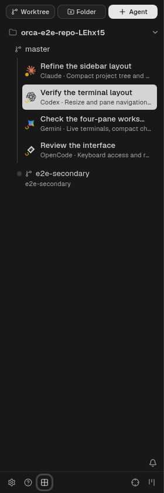
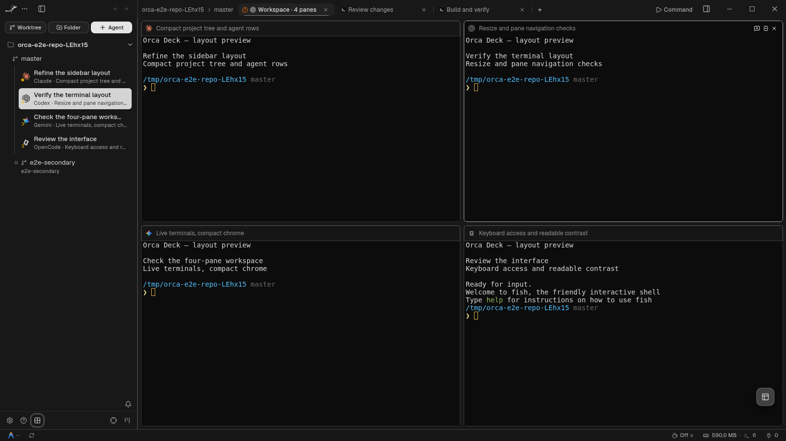
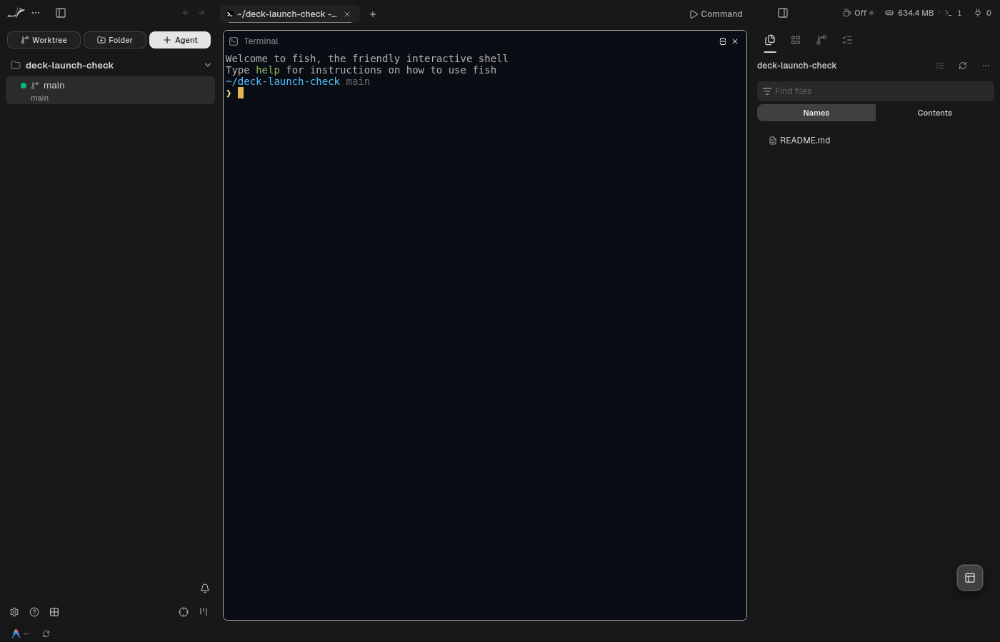
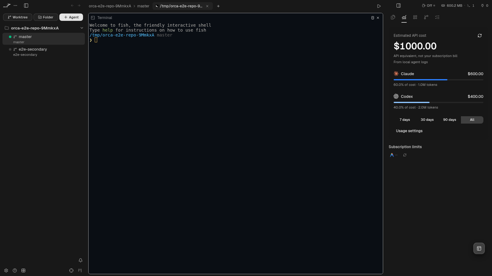

# Orca 1.4.220 — Deck UI installed and verified

Orca on this machine now opens the full Deck renderer from
`~/Applications/Orca-1.4.220-Deck-Usage/AppRun`. Quit Orca and reopen it from
the application menu to load the new renderer. The previous running instance
was left running; the installer does not close active terminals.

## Included

The integration carries all 40 files from Deck commit `f91a89b0`, adapted to
release `v1.4.220`: sidebar actions and agent rows, tab surfaces and breadcrumb,
pane headers and selection borders, and Agent splitting into the hovered pane.

The renderer imports Deck appearance once per Orca profile: sidebar tint,
full agent rows, sidebar widths, zoom, terminal theme and inactive pane opacity,
and automatic tab titles. Later preference changes survive restart. Import
completion is recorded only after both settings and UI saves succeed.

Only appearance is imported. Orca keeps its existing accounts, projects,
workspace sessions and terminal layouts. The Deck profile is not copied.
The editor tab close button stays reachable by keyboard while the file is dirty.

## Verification

- Renderer TypeScript check passed.
- 34 focused unit/component tests passed across 7 files, including profile
  separation, retry after a failed appearance save and preservation of later edits.
- Five Deck Electron checks passed: agent tiling, four-pane sidebar/navigation,
  light/dark tabs and overflow, drag/pin controls, and editor/browser keyboard controls.
- Changed-code quality gate passed with `ORCA_CODE_QUALITY_BASE=v1.4.220`.
- Full E2E and production builds passed, including the daemon load guard.
- Packaged application smoke passed with a disposable profile and isolated home:
  hidden windows, Deck controls, appearance import and restart persistence.
- All 3,838 original files outside the renderer and the main UI route normalizer
  retain their bytes, executable flags and unpacking flags. The release main bundle
  differs only by accepting the built-in Usage route; a byte comparison verifies
  that single change. All 1,146 renderer files match the production build.
- Installed archive hash matches `dist/orca-deck-usage/verification.json`.

Tests run with `ORCA_BACKGROUND_LAUNCH=1` and CDP. No native-focus tests,
full repository suite, macOS/Windows execution or live SSH session were run.

## Package and rollback

The verified package and one-off installer are in `dist/orca-deck-usage/`.
The installer has already run. The original AppImage and previous Deck runtime
remain available. No automatic updater was added; an official update or
reinstallation can replace the local customization.

To restore the previous Orca launcher, run:

```sh
cp -- "$HOME/Applications/Orca-1.4.220-Deck-Usage/original-orca.desktop" \
  "$HOME/.local/share/applications/appimagekit_ae11192f5fe223a1e05f0008606929e5-Orca.desktop"
```

Appearance fields before synchronization are saved in
`dist/deck-ui-settings-backup-20261013-081631/appearance-before.json`.
The working diff and Git index before completing integration are backed up in
`dist/deck-integration-backup-20261013-081257/`.

## Sidebar refinement

Agent provider icons are centered across both text lines. A small round status
badge overlaps the lower left edge; waiting uses an amber dot, and a small working
status ring rotates. Provider logos stay still. Agent rows retain
keyboard navigation and the selected row's contrasting surface.

Clicking a sidebar workspace with no tabs opens the existing Agent picker,
with an explicit Blank terminal choice. Cancelling leaves the workspace empty;
clicking a workspace with an existing editor, browser, agent or terminal tab
returns to that content. Both git worktrees and folder workspaces follow this
flow. Agent recovery and host inventory finish before an empty-workspace menu
opens, and local/paired-client background seeders respect its empty tab group.

This refinement passed renderer typecheck, the changed-code quality gate,
focused unit checks (including remote inventory and retry cases), four Electron
checks covering the sidebar, agent tiling and both workspace kinds, and a
packaged-app launch/cancel/open/restart check with isolated home and profile.



## Seamless workspace refinement

Workspace chrome and terminal gutters share the sidebar appearance through the
canonical `workspace-canvas` token. Each terminal sits 6 px inside the workspace
with a rounded hairline border. Idle divider lines recede; hover and drag still
show the resize handle. A 32 px header reserves matching terminal space, and
the active pane keeps the terminal surface while other headers lift subtly.
Tabs use a quiet background without the boxed selection outline.

Project and branch rows now have a 2 px virtual-row gap and 2 px workspace
padding. The virtualizer and drag placement consume the same gap constant.
Appearance preferences and agent/session routing are unchanged.

Validation covers 40 sidebar layout tests, renderer typecheck and changed-code
quality, hidden Electron screenshots across themes and viewport widths, tab
overflow/drag/keyboard controls, agent tiling, folder/worktree launch choices,
and packaged-app restart with an isolated profile. Terminal screen bounds and
header alignment are checked after resizing.



## Quiet chrome and Linux titlebar

Linux Deck replaces the app's minimize, maximize and close buttons with the
existing awake, memory/session and port controls at the top right. The same
components move through a React portal, so they keep their host-aware data and
menus without a second subscription or a second resource scan. Windows keeps
its window controls; macOS keeps native traffic lights; paired web clients keep
their existing chrome. The top area reserves space in the titlebar and scrolls
when needed, independently of the footer's usage density.

Workspace action buttons size to their labels and wrap at narrow sidebar widths.
Sidebar edges, toolbar/header/footer separators, workspace row outlines and the
explorer mode selector's framing are removed. Pane outlines and keyboard focus
indicators remain. Agent provider logos stay still while the small working
status ring continues to animate.

Validation includes 17 focused policy/density/explorer tests, renderer typecheck,
changed-code quality, hidden Electron checks for both zoom settings and a narrow
viewport, top status popovers, no duplicate footer counters, pane geometry and
stationary provider logos. The packaged renderer is checked with an isolated
profile before installation.



## Sidebar Usage and pane interaction refinement

The right sidebar adds a Usage item available for git, folder and SSH workspaces.
It reads local Claude, Codex, OpenCode and Muse snapshots through the existing
usage APIs and overview model. Independent all-local 7/30/90/all queries leave the
full Stats page's saved scope and range untouched. Missing data stays unavailable;
a failed provider keeps other results visible with an error message, and stale
responses cannot overwrite a newer period. Cost remains an API equivalent, with
unpriced tokens called out. Disabled tracking stays disabled.

Existing subscription controls move into this panel through a portal, preserving
account switching and rate-limit menus. Linux removes the footer and moves its
remaining attention controls to the top status area. Command becomes a compact
Play control with a tooltip; active tab underlines are hidden. Faint hierarchy
guides return only to agent groups and nested file rows.

The whole pane header can start the existing drag operation, excluding actions
and rename input. Existing edge drop zones and stable pane/session identities are
retained. Mouse focus is enabled once per profile and respects later preference
changes, held-button selection/drag gates and the focused-app gate. Header hover
uses the same policy as terminal content.

The release runtime remains original except for one UI allowlist change in
`out/main/index.js`, admitting `usage` so the panel can survive restart. The
one-off package scripts assert the exact release function, check its known,
plugin and invalid routes, and compare every other main byte and archive flag.
No new RPC method, stream opcode, execution-host status store or account copy is
introduced. Older readers safely normalize the new sidebar key to Explorer.

Validation includes 46 focused unit tests, main and renderer typechecks,
changed-code quality, hidden Electron tests for costs, range changes, tree guides,
Command/dialog bounds, header dragging and mouse focus, plus an isolated-profile
packaged-app restart. Native OS focus behavior is not exercised on the user's
desktop; the in-app focus gate is simulated in the hidden test renderer.



[Nested tree guides](../assets/orca-deck-tree-guides.png) and
[reordered panes](../assets/orca-deck-pane-reordered.png) were captured from the
same hidden Electron check.
