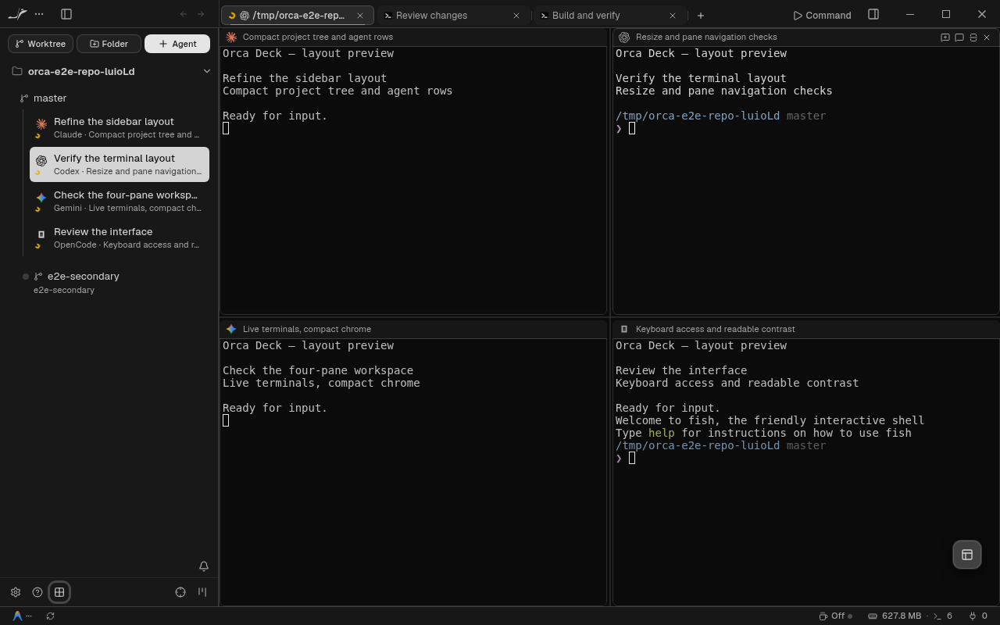

# SpaceVibe Deck UI reference

## Direction

The user supplied the Deck demo loop and workspace screenshot on 2026-10-13.
Keep these as the visual reference for this Orca variant: charcoal chrome,
compact tabs and pane headers, thin neutral seams, restrained selection, and
content given most of the window. Preserve Orca's identity and capabilities.

Video: <https://deck.spacevibe.dev/landing-prototype/assets/demo-loop.webm>.
The [supplied workspace reference](../assets/deck-workspace-reference.png) is
retained alongside these notes for later UI passes.

Source: <https://github.com/mxrsv/spacevibe-deck> at
`b10004dca0d4a8f22faba72ec6e6eefd8f569f00`, cloned separately into
`/home/towfienes/Projects/orca-deck-reference`. The reference is not a build
dependency and its runtime is not installed or launched.

## Implementation findings and adaptation

| Reference implementation                              | Finding                                                                                                                    | Orca adaptation                                                                                                                                               |
| ----------------------------------------------------- | -------------------------------------------------------------------------------------------------------------------------- | ------------------------------------------------------------------------------------------------------------------------------------------------------------- |
| `src/styles/01-tokens.css`                            | 34 px frame, 6 px tab radius, 150 ms transitions; neutral rest/hover/selection steps.                                      | Keep Orca's 36 px window alignment and theme roles; inset compact tab surfaces with 150 ms color transitions.                                                 |
| `src/styles/05-tab-bar-toolbar.css`                   | 25 px chips capped at 210 px; one truncation point; active surface and hairline do not change geometry.                    | 26 px chips in the existing 32 px strip, 180/200 px preferred widths, 120 px readable floor. Insets and an inset outline leave measured drag slots unchanged. |
| `src/ui/tab-strip.tsx`                                | Shared chip shell for surface types; close target stays in layout; pin/menu/close ownership remains in the existing model. | Shared styling for terminal, file, simulator, browser and hosted-browser tabs. Preserve Orca's close guards, pins and context menus.                          |
| `src/ui/tab-strip-drag.ts`                            | Defer a drag until a threshold; suppress accidental selection; cancel on blur/Escape; scroll at edges.                     | Keep Orca's existing dnd-kit gesture, cancellation and edge-scroll implementation. No second drag controller.                                                 |
| `src/ui/spaces/space-bar.tsx`                         | Stable name footprint; horizontal reveal avoids scrolling the entire app; delayed hover previews.                          | Keep Orca's fixed tab slots, hover cards and active-tab docking. Do not replace terminal tabs with Deck's space marks.                                        |
| `src/ui/tab-bar.tsx`, `src/ui/stage-surface-strip.ts` | Frame placement is separate from surface selection and lifecycle.                                                          | Refine the renderer chrome only; keep Orca's session store, SSH ownership and mixed-version protocol untouched.                                               |
| `src/styles/06-stage-panes.css`                       | Compact stage/pane framing and a clear hierarchy between chrome and terminal content.                                      | Quieter existing pane headers, bounded summary width and unchanged terminal measurement.                                                                      |

The current Deck source differs from the supplied video: terminal navigation
uses space marks/breadcrumbs and its trailing new-tab button was removed.
Those product changes are not part of this refinement. Orca keeps its named
tabs, new-tab menu, agent attention indicators, window controls and shortcuts.

## License

SpaceVibe Deck is MIT licensed, copyright (c) 2026 mxrsv. Its small-tab surface
and state ladder inform `deck-tabs.css`; the implementation uses Orca's tokens
and existing components. The upstream notice is retained in
[MIT notice](../../resources/licenses/spacevibe-deck/LICENSE), alongside Orca's
other bundled notices.

## Validation

`tests/e2e/deck-tabs.spec.ts` exercises actual Chromium layout in hidden Electron:
light/dark themes, compact height, stable active hover, 13-tab overflow at 900 px,
active docking, rename, keyboard close, drag reorder, pinning, new-tab menu and reduced motion.
Mixed terminal/editor/browser tabs retain matching heights; marking a file dirty
keeps its width stable and its close control reachable by keyboard.
`deck-chrome.spec.ts` checks the existing four-pane rail at 1280 and 1050 px.
The existing active-dock regression checks that new tabs reveal without flicker.
Unit tests cover the shared tab variants and existing menu/overflow behavior.

Native macOS/Windows and a live SSH connection require separate verification.
The renderer typecheck and changed-code quality gate pass. The repository-wide
E2E typecheck reports errors outside these modified specs; it is not a clean gate.

